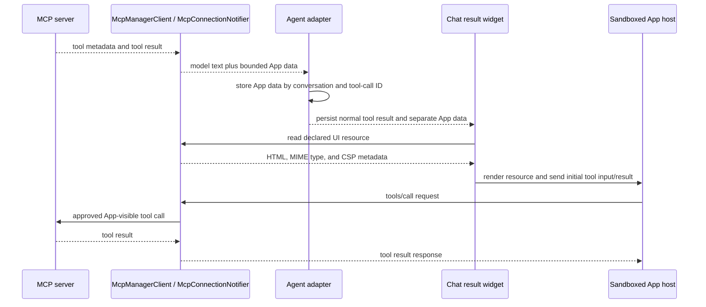

# MCP Apps Host

This document maps the app-owned MCP Apps host in chat tool results. It records
the data path and trust boundaries that changes to MCP App rendering must keep.
Source paths below are relative to `apps/auravibes_app/lib/`; test paths are
relative to `apps/auravibes_app/`.

## Data Flow

The model receives `modelText`. Raw App result data stays in
`MessageToolCallEntity.appData` and is delivered only to the embedded view.
Ordinary tool result text remains visible in chat.

## Ownership

- `services/mcp_service/mcp_manager_client.dart` advertises the MCP Apps
  capability and exposes resource reads plus raw tool results.
- `services/mcp_service/mcp_app_tool_metadata.dart` parses the declared
  `ui.resourceUri` and `ui.visibility` metadata.
- `notifiers/mcp_connection_status.dart` filters model-visible tools, limits
  resource reads to the declared URI, and checks App visibility for App calls.
- `features/chats/agent_adapters/resolved_tool_service.dart` separates App data
  from model text and scopes pending data by `(conversationId, toolCallId)`.
- `features/chats/agent_adapters/agent_tool_execution_service.dart` and
  `features/chats/agent_adapters/app_approve_tool_call_data_provider.dart`
  persist App data with the tool call. The batch path is in
  `features/chats/usecases/batch_tool_approval_usecase.dart`; persisted data is
  represented by `domain/entities/message_tool_call_entity.dart`.
- `features/chats/widgets/chat_messages_widget.dart` keeps the text result and
  mounts `features/chats/widgets/mcp_app_tool_result.dart` for eligible calls.
- `services/mcp_service/mcp_app_message_bridge.dart` handles App protocol
  messages. `services/mcp_service/mcp_app_resource.dart` parses resources and
  builds the platform host page.

## Trust And Lifecycle Rules

- Treat resource HTML as untrusted. Keep it in a sandboxed iframe; never load it
  as the host document.
- Require the exact declared `ui.resourceUri`; accept only
  `text/html;profile=mcp-app` resources. Read CSP from resource `_meta.ui.csp`.
- Bound resource HTML to 2 MiB and inbound App messages to 1 MiB. Filter CSP
  domains and URL schemes before building host policies.
- On native platforms, sandbox the App iframe with scripts enabled and omit
  same-origin access. On web, use the cross-origin data-URL proxy and keep the
  inner App iframe sandboxed. Check message sources at each frame boundary.
- Register JavaScript handlers for the main frame only. Route App `tools/call`
  through the existing approval decision and MCP connection APIs; reject tools
  excluded by App visibility.
- Send resource teardown before closing, collapsing, retrying, or disposing the
  view. Reset the bridge before retry so the next view receives initial data.
- Keep fallback text visible when resource loading or the embedded view fails.
  App data remains bounded and outside model context.

## Regression Tests

- Metadata and visibility: `test/services/mcp_service/mcp_app_tool_metadata_test.dart`
- Resource size, MIME type, CSP, and isolation:
  `test/services/mcp_service/mcp_app_resource_test.dart`
- Initialize, result delivery, tool calls, and teardown:
  `test/services/mcp_service/mcp_app_message_bridge_test.dart`
- Capability negotiation, resource reads, and raw results:
  `test/services/mcp_service/mcp_manager_client_auto_transport_test.dart`
- Result persistence and approval:
  `test/features/chats/agent_adapters/resolved_tool_service_test.dart`,
  `test/features/chats/usecases/batch_tool_approval_usecase_test.dart`, and
  `test/notifiers/mcp_connection_notifier_test.dart`
- Related chat result coverage:
  `test/features/chats/widgets/chat_messages_widget_test.dart`. There is no
  dedicated embedded WebView widget test yet.

The protocol reference is the
[MCP Apps specification, 2026-01-26](https://github.com/modelcontextprotocol/ext-apps/blob/main/specification/2026-01-26/apps.mdx).
