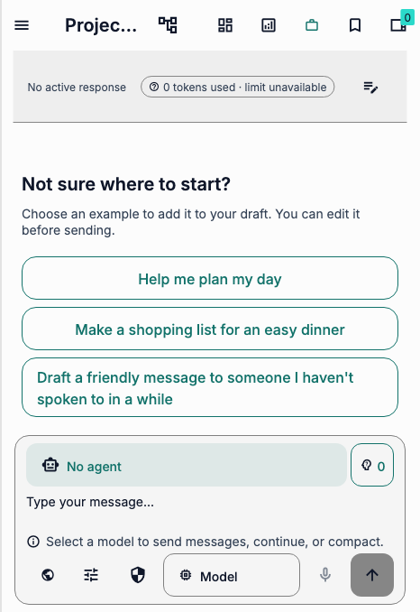
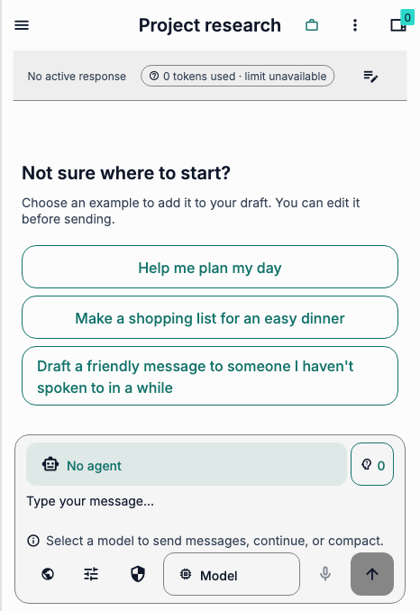
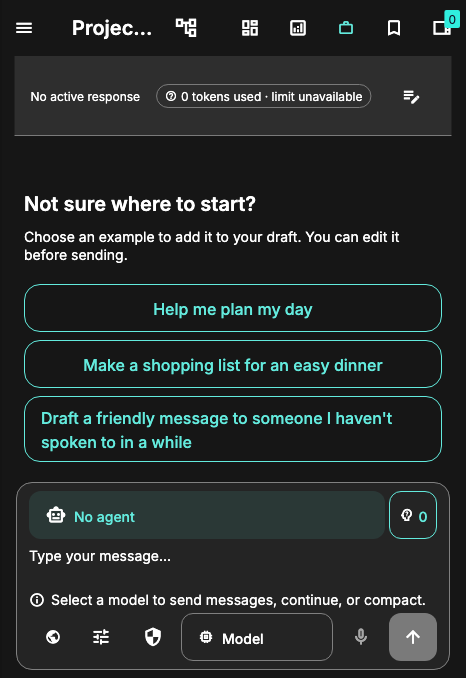
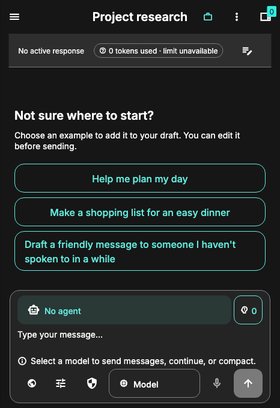
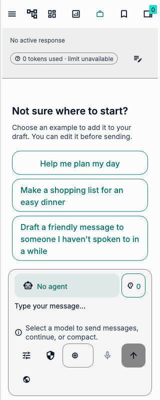
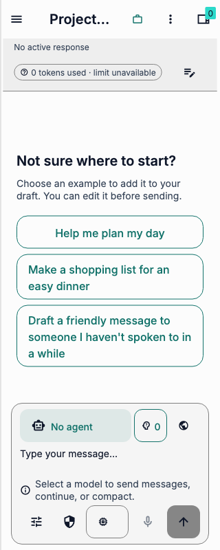
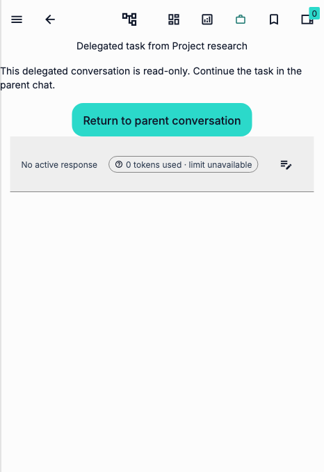
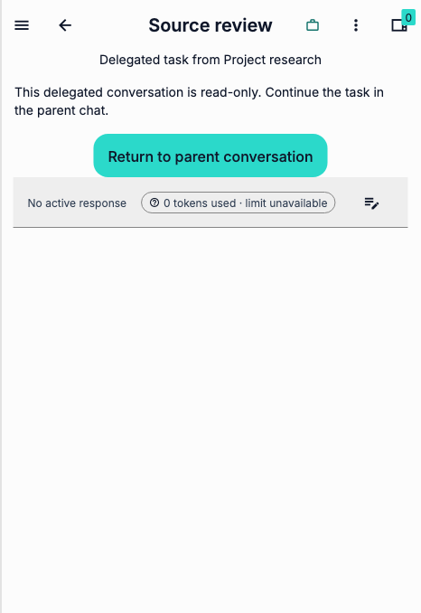
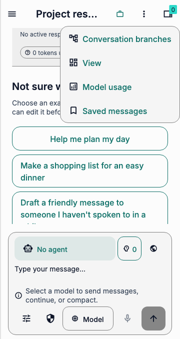

# Conversation layout audit

## Scope and evidence

The randomly selected conversation route lets someone read a chat, continue it,
inspect related work, and return from a delegated conversation. The audit covers
the header, empty conversation, composer, and delegated-chat notice. The same
composer also appears on the new-chat route.

Evidence is source inspection and Flutter widget-test captures of production
routes with an in-memory workspace, no model, and no cloud accounts. Captures
use app fonts on macOS. They do not represent native screen-reader behavior or
observed user sessions. The JSON sidecars record viewport, theme, and fonts.

## Findings and fixes

1. **Conversation title and actions compete on compact screens.** At 466 px,
   the original header truncates `Project research` to `Projec...`; at 320 px
   the title disappears. Six icons compete with it. Icon actions have tooltips
   but no visible labels.
   This can make similar conversations harder to distinguish and actions harder
   to recognize. **Severity: medium. Confidence: medium.** On compact layouts,
   group branches, views, model usage, and saved messages in a labeled menu.
   The menu's accessible label includes the conversation title. Keep
   background-work and browser status visible. Wide layouts retain direct
   actions. Verify the title and each menu destination in the route fixture.

2. **The network disclosure occupies a separate row on very narrow screens.**
   At 320–360 px the disclosure appears alone under the composer controls,
   increasing composer height and reducing space for the conversation.
   **Severity: low. Confidence: medium.** Place the same accessible disclosure
   alongside the agent and skill controls. Keep it visible for local workspaces
   and absent for cloud workspaces. Verify its dialog on both new and existing
   chats.

3. **Delegated-chat guidance touches the screen edge.** The read-only notice
   starts at the left edge in the compact route capture, making the explanation
   feel detached from surrounding content. **Severity: low. Confidence:
   medium.** Apply the existing horizontal spacing token while retaining the
   parent-chat action. Verify both text edges at 320 px.

4. **The status strip consumes avoidable vertical space.** Its original equal
   horizontal and vertical padding gives a single row an 80 px footprint in the
   466 px capture. **Severity: low. Confidence: medium.** Reduce only vertical
   padding, retaining the existing controls and their interaction targets.

5. **Capture cases leak safe-area padding.** In a multi-case run, the first
   dark capture inherited the previous case's 40 px right inset. A standalone
   run exposed the difference. **Severity: low. Confidence: high.** Reset both
   test-view padding values after each route case so later captures describe
   their stated viewport.

The anti-slop review found redundant visual weight in the crowded header and
oversized status strip; the fixes reduce both without adding decorative surfaces.
The empty-state examples and the model-required message remain visible. The
network disclosure remains an explicit action, including when the model is
unavailable.

## Related surfaces and validation limits

The parent and delegated conversation routes share the updated header. The new
and existing chat screens share the updated composer. No other production
callers of the three moved header actions were found. A documentation search
found no instructions that depend on their former compact positions.

The route tests exercise every menu destination, a 320 px composer on both
chat routes, light and dark themes, 466 px and 951 px layouts, Spanish at 1.5×
text, and Escape dismissal. Real-device layout, native screen readers,
different model and streaming states, and comprehension remain unverified.

## Before and after

The before captures use production code from `68b02c5a8`; the after captures
use the changes described above, merged onto that commit. Their sidecar
fingerprint is the SHA-256 of the tracked Dart diff against `923cb40ac`. The
same fixture and viewport are used for each pair; no drag is active in these
captures. The narrow baseline intentionally fails the new positioning
regression after writing its capture.

### Conversation header, 466 × 678

### Conversation header, dark theme

### Existing-chat composer, 320 × 800

### Delegated conversation, 466 × 678

### Compact action menu

