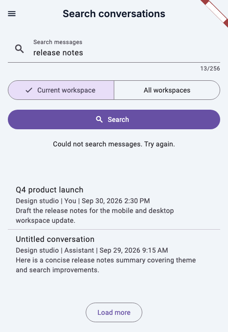
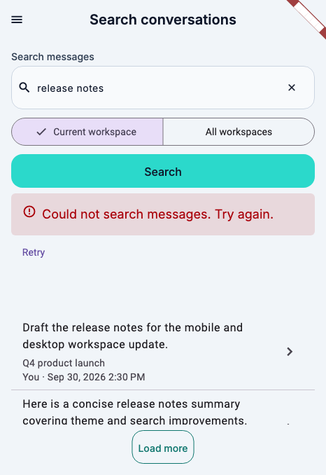

# Conversation message search UX audit

Scope: randomly selected [`ConversationMessageSearchScreen`](../../../apps/auravibes_app/lib/features/chats/screens/conversation_message_search_screen.dart), opened from the Chats list app bar (`Search messages` → `ConversationSearchRoute`). Grounded in [target users](../../product/target-users.md), [interaction rules](../../../.agents/skills/ux-view-clarity/references/interaction-rules.md), and [visual design rules](../../../.agents/skills/ux-view-clarity/references/visual-design-rules.md). Evidence comes from source inspection and deterministic Flutter widget-test renders (`466 × 678` Duo closed viewport with app fonts). No live user sessions or analytics were available.

## User goal and task flow

- **Goal:** Find a previous chat message by keyword across the current workspace or all workspaces, scan matching message excerpts with enough context to recognize the right conversation, and open that message directly in its conversation.
- **Route:** `ChatsListScreen` (`Search messages` action) → `ConversationSearchRoute` (`ConversationMessageSearchScreen`) → enter query, choose scope (`Current workspace` or `All workspaces`), run search → inspect matching excerpts / recover from errors / load more → tap a result to navigate to `ConversationRoute(workspaceId, chatId, messageId)`.

---

## Iteration 1: Search controls, query recovery, and submitted-query state

### Findings

1. **Active Search action on empty input and unsynchronized query state**
   - **Task step / view:** Entering or editing a search query in `ConversationMessageSearchScreen`.
   - **Evidence:** Code inspection (`_ConversationMessageSearchScreenState.build`, `_ConversationSearchActionButton`) and baseline render (`before.png`).
   - **User problem & impact:** `_ConversationSearchActionButton` remained enabled when the query field was empty or whitespace (`onPressed: isLoading ? null : ...`); tapping `Search` did nothing without feedback. In addition, `_SearchResults` received `_queryController.text` instead of `_activeQuery`, while typing in `_queryController` did not update state, leaving status checks coupled to unsubmitted text.
   - **Severity:** **high** | **Confidence:** **high**
   - **Recommendation:** Track non-empty and non-whitespace input state, disable the `Search` `AuraButton` when the trimmed query is empty or a search is in progress, and pass `_activeQuery` (the submitted query) to `_SearchResults`.

2. **Missing clear-search action and permanent `0/256` character counter clutter**
   - **Task step / view:** Revising or clearing a query in `_ConversationSearchQueryField`.
   - **Evidence:** Code inspection (`TextField(maxLength: 256)`) and baseline render (`before.png` showing `13/256` below the input with no clear button).
   - **User problem & impact:** Using `maxLength: 256` on a raw Material `TextField` rendered a permanent character counter (`0/256` / `13/256`) between the query input and the workspace scope selector, adding visual noise to a simple lookup task. Users also had no one-tap clear action to reset the query and results.
   - **Severity:** **medium** | **Confidence:** **high**
   - **Recommendation:** Replace the raw `TextField` with `AuraInput` using `LengthLimitingTextInputFormatter(256)` to enforce the 256-character cap without permanent counter chrome, and add a trailing `Clear search` `AuraIconButton` (`Icons.close`, `LocaleKeys.common_clear_search`) that clears the input and resets active results.

### Re-audit after Iteration 1 fixes

- `AuraInput` and `AuraButton` align with Aura spacing tokens (`AuraSpacing.sm` / `AuraSpacing.md`), the noisy `13/256` counter is gone, `Search` is disabled when the input is blank, and `Clear search` resets both the input and results.
- **Remaining gap:** Inspecting the rendered result rows shows inverted text hierarchy and redundant workspace metadata.

---

## Iteration 2: Result row hierarchy, scope-aware metadata, and open affordance

### Findings

1. **Inverted result row hierarchy hides the matched message excerpt**
   - **Task step / view:** Scanning search results in `_ConversationMessageSearchResultTile`.
   - **Evidence:** Code inspection (`_ConversationMessageSearchResultTile`, `_ConversationMessageSearchResultSubtitle`) and rendered view.
   - **User problem & impact:** Each row placed the conversation title in `ListTile.title` and buried the matching message `excerpt` at the bottom of `subtitle` directly underneath a pipe-delimited metadata string (`Workspace | Role | Date`) with zero vertical spacing. When searching for a message, the matched excerpt is the primary recognition signal (and leads in `MessageBookmarksScreen`), whereas conversation title and author/timestamp are supporting context.
   - **Severity:** **medium** | **Confidence:** **high**
   - **Recommendation:** Promote `result.excerpt` (`maxLines: 2`, `overflow: .ellipsis`) to `ListTile.title` and group the conversation title (with `Untitled conversation` fallback) and metadata line in `subtitle` with a `4 px` top gap.

2. **Redundant workspace name in `Current workspace` scope and missing open affordance**
   - **Task step / view:** Reading result metadata and opening a matched message from `_ConversationMessageSearchResultTile`.
   - **Evidence:** Code inspection (`_ConversationMessageSearchResultMetadata`) and compact `466 × 678` render (`before.png`).
   - **User problem & impact:** When searching within `Current workspace`, every result row still prefixed its metadata with `${result.workspaceName} | ...`, repeating known scope context and crowding out the author role and timestamp on compact widths. Timestamp formatting (`DateFormat.yMMMd().add_jm()`) also omitted the active locale, and rows lacked the trailing `Icons.chevron_right` affordance used by `MessageBookmarksScreen`.
   - **Severity:** **medium** | **Confidence:** **high**
   - **Recommendation:** Show `result.workspaceName` in the metadata line only when `_scope == .allWorkspaces` (`Workspace · Role · Timestamp` vs `Role · Timestamp`), pass the active locale to `DateFormat.yMMMd(locale).add_jm()`, and add `trailing: const Icon(Icons.chevron_right)`.

### Re-audit after Iteration 2 fixes

- Result rows now lead with the matched message excerpt, present clean supporting metadata without repeating the current workspace name, and display a consistent trailing chevron.
- **Remaining gap:** Inspecting the loading, error, and pagination states reveals unstyled error text with no in-place retry action and an unlabeled raw loading spinner.

---

## Iteration 3: Error recovery, partial-result callout, and loading state clarity

### Findings

1. **Full and partial search failures lack a semantic error callout and Retry action**
   - **Task step / view:** Recovering from a failed search (`hasError && !hasResults`) or a partial cloud workspace / pagination failure (`hasError && hasResults`).
   - **Evidence:** Code inspection (`_SearchResultsStatus`, `_SearchResultsError`) and baseline render (`before.png`).
   - **User problem & impact:** Both full and partial error states rendered plain centered text (`"Could not search messages. Try again."`) without an `AuraCallout` surface or a `Retry` button. If a remote workspace failed in `All workspaces` mode or `Load more` failed on a later page, users had no direct recovery control on the error notice.
   - **Severity:** **high** | **Confidence:** **high**
   - **Recommendation:** Replace the plain error text with `_SearchResultsErrorBanner`, pairing `AuraCallout(tint: .error, icon: Icons.error_outline)` with a `Retry` action (`LocaleKeys.chats_screens_conversation_search_target_retry`) that invalidates the failed page provider and retries either the initial search or the failed pagination offset.

2. **Unlabeled raw loading indicator and non-Aura pagination button**
   - **Task step / view:** Waiting for search results (`_SearchResultsStatus`) or loading the next page (`_SearchResultsFooter`).
   - **Evidence:** Code inspection (`CircularProgressIndicator()`, `OutlinedButton`).
   - **User problem & impact:** Initial search rendered a raw `CircularProgressIndicator()` in both `_SearchResultsStatus` and `_SearchResultsFooter` simultaneously while ignoring the existing localized `LocaleKeys.chats_screens_conversation_search_loading` (`"Searching messages…"` / `"Buscando mensajes…"`). Pagination used a raw Material `OutlinedButton` instead of `AuraButton`.
   - **Severity:** **low** | **Confidence:** **high**
   - **Recommendation:** Render `AuraSpinner` with `TextLocale(LocaleKeys.chats_screens_conversation_search_loading)` during initial search loading, hide the footer when `hasMore` is false so initial loading never shows two spinners, and use `AuraButton(variant: .outlined, size: .small, isLoading: isLoading)` for `Load more`.

### Final re-audit after Iteration 3 fixes

- All three iterations' findings are resolved and verified in widget tests (`conversation_message_search_screen_test.dart`):
  - Search controls use `AuraInput` and `AuraButton`, omit the `0/256` counter chrome, disable submission when empty, and support one-tap `Clear search`.
  - Result rows lead with the matched message excerpt, adapt metadata to the selected workspace scope, and show a trailing chevron.
  - Loading states display `AuraSpinner` with `"Searching messages…"`, and error states render an `AuraCallout` with a working `Retry` button.

## Before and after

Captures rendered at `466 × 678` (Duo closed viewport, light theme, English, app fonts loaded).

| Before | After |
| --- | --- |
|  |  |
