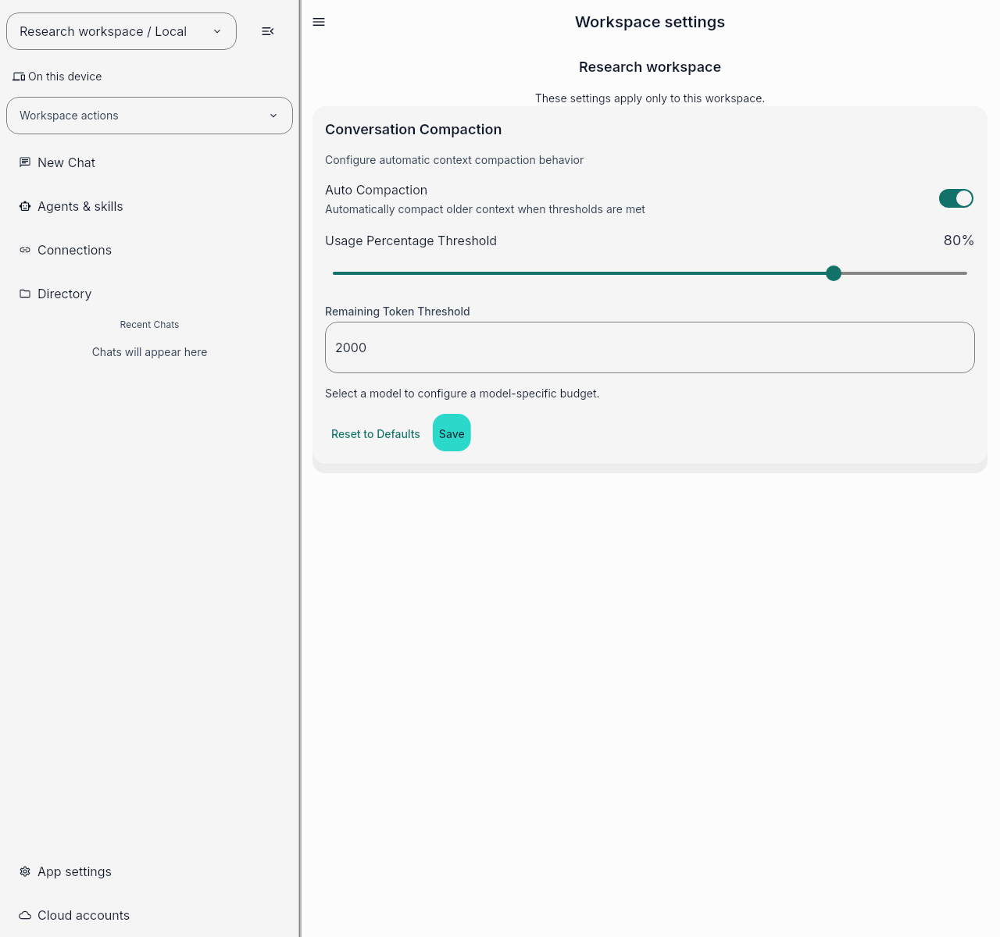
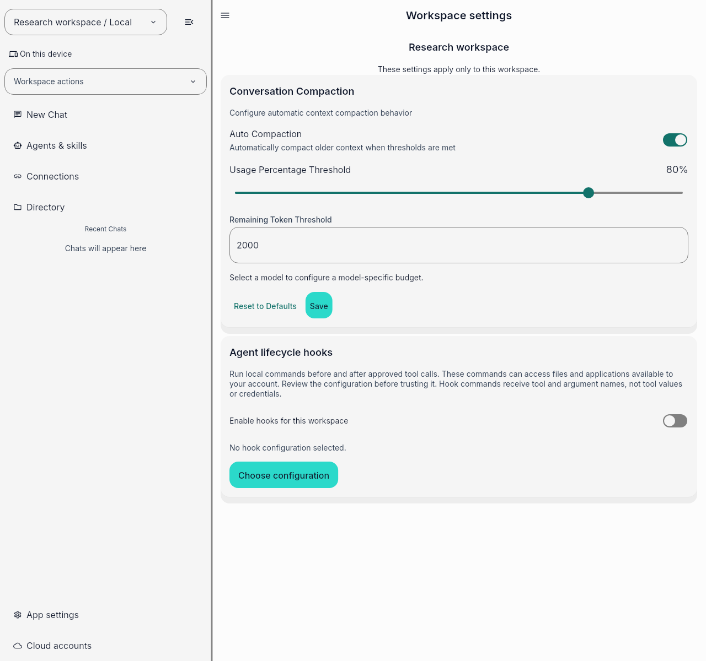

# Trusted lifecycle hooks settings review

These are unmodified PNGs rendered by Flutter from the actual `MyApp` production
router and workspace settings route. They use real feature providers, an isolated
file-backed SQLite database, and persisted Linux preferences. The seeded local
Research workspace has no connections, credentials, or hook opt-in.

| Capture | Source commit | Hosted run | Artifact |
| --- | --- | --- | --- |
| Before | `1aaa31f61128fe810ca35ef7a00205edb9233175` | [41483461541](https://github.com/auravibes-apps/auravibes/actions/runs/41483461541) | `13160334654` |
| After | `51fbb99ca164c0cfed7759ce27b7e997ea410d8d` | [41490375192](https://github.com/auravibes-apps/auravibes/actions/runs/41490375192) | `13163583962` |

The matched provenance JSON differs only in `sourceSha`. Both views use the same
1280 by 1200 viewport, English locale, light theme, font files, device and text
scale, fixture storage, and route. The baseline was captured and inspected before
the UI slice was changed. The after image is byte-identical to the earlier capture
at `5411956caac49df9636930a297b5a2b8f1dfd830`.

The harness is `.github/fixtures/issue_1598_settings_capture.dart.fixture`, executed
by `.github/workflows/issue-1598-review.yml`. The only infrastructure override
selects an isolated real database. The repository's widget test configuration
substitutes empty secure storage; no credentials or cloud accounts are seeded.
These are Flutter widget-test Skia captures, not native desktop window captures.
They do not establish native file-picker, OS process, or cloud behavior.

