# Agent authoring UX audit

**Date:** 2026-11-03

**Selected surface:** Agent Detail, plus its create route and related Skill and connected-view recovery states.

**Goal:** create or edit a reusable agent, understand its instructions and configuration, and recover without losing a draft.

**Evidence:** production Flutter widgets and routes rendered with controlled in-memory fixtures, source inspection, and widget tests. No user observation or analytics were available.

Code reviewed: [Agent Detail](../../../apps/auravibes_app/lib/features/agents/screens/agent_detail_screen.dart), [Skill Detail](../../../apps/auravibes_app/lib/features/skills/screens/skill_detail_screen.dart), [Skill resource editor](../../../apps/auravibes_app/lib/features/skills/screens/skill_resource_edit_screen.dart), and [connected-view editor](../../../apps/auravibes_app/lib/features/workspaces/widgets/workspace_connected_editor.dart). Recovery and capture scenarios are in [the UX validation tests](../../../apps/auravibes_app/test/widgets/agent_authoring_recovery_test.dart).

## Findings and fixes

1. **High severity; high confidence — a connected view could be saved without a verified Connection.** A failed Connection list left Save enabled, and a saved selection could remain in state after disappearing from the available list. The related editor also had no Retry for tools or Connection loading, and a tools failure hid Cancel. The fix disables Save until the required Connection is present in the loaded choices, adds Retry to both failures, and retains Cancel for a tools failure. Verification: fail and retry each load; confirm Save is disabled during failure and after a selected Connection disappears, and enabled when that Connection is available.
2. **High severity; high confidence — loading failures blocked agent and Skill editing without recovery.** Agent Detail displayed a tools failure as a skills failure. Skill Detail and its resources list had the same missing-retry pattern. Resource editing could display an editable form while the parent Skill failed to load. The fix names the failed dependency, retries the failing provider, waits for the parent Skill, and retains drafts during a failed refresh. Verification: trigger each failure, enter a draft after recovery, fail a refresh, retry, and confirm the draft remains.
3. **Medium severity; high confidence — an unknown local failure claimed the cloud service was unavailable.** Skills and connected-view setup used the cloud fallback for untyped local failures. The fix supplies a task-specific fallback while retaining typed permission and authentication messages. Verification: inject local, permission, and authentication failures and check their messages.
4. **Medium severity; medium confidence — “system prompt” exposed implementation language.** The Agent editor, its empty state, and related navigation described reusable instructions as prompts. The existing Markdown editor already calls them instructions. The fix uses “instructions” consistently in English and Spanish, including validation and edit actions. Verification: create and edit an agent in each language; confirm the field and editor use the same term. Comprehension remains a hypothesis without user research.
5. **Low severity; high confidence — enlarged Spanish error text touched the viewport edge.** A 360 × 678 dark capture at 1.4× text scale showed the error message without a side inset. The fix uses the shared recovery view's inset for related centered messages. Verification: inspect the same capture and assert the message stays inside the viewport.

## Visual and interaction review

The sampled normal Agent Detail view already groups its fields and keeps Save visible. No decorative gradients, sparkles, invented status badges, or other listed visual-blacklist violations were observed in the sampled frames. This does not establish accessibility conformance or prove user comprehension. Keyboard, native screen-reader, and live-device behavior require separate validation.

## Before and after captures

Each PNG has a same-named JSON sidecar describing the route, fixture, viewport, theme, fonts, and renderer. Captures use Flutter widget-test Skia on macOS, not native platform typography. The connected editor is shown in a synthetic test dialog. Its baselines use the original connected-editor source with the current test fixture and other working-tree changes. Skill recovery baselines were captured during this change before their individual fixes; the large-text pair compares two iterations of the new recovery message. The resource-list pair uses different scroll offsets to show Retry. Fixture identifiers are synthetic. The after-capture fingerprint is a SHA-256 of the tracked Git diff at capture time, not a commit hash; it excludes untracked files.

| State | Before | After |
| --- | --- | --- |
| Agent instructions | 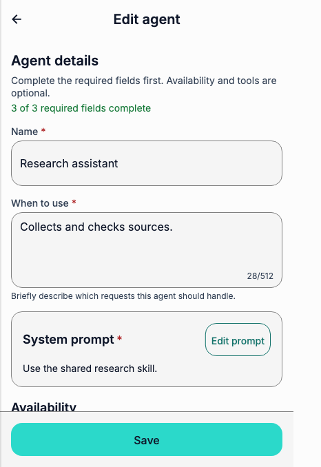 | 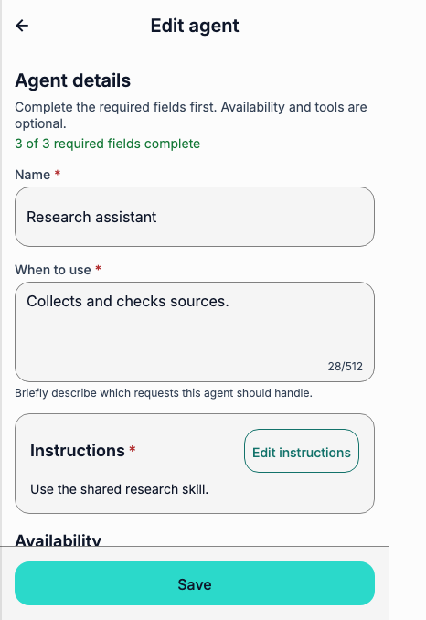 |
| Agent tools failure | 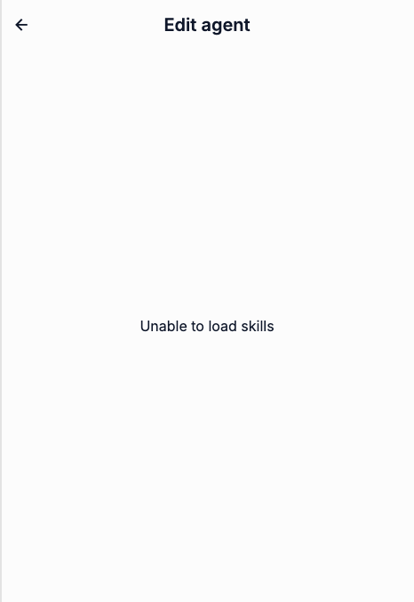 | 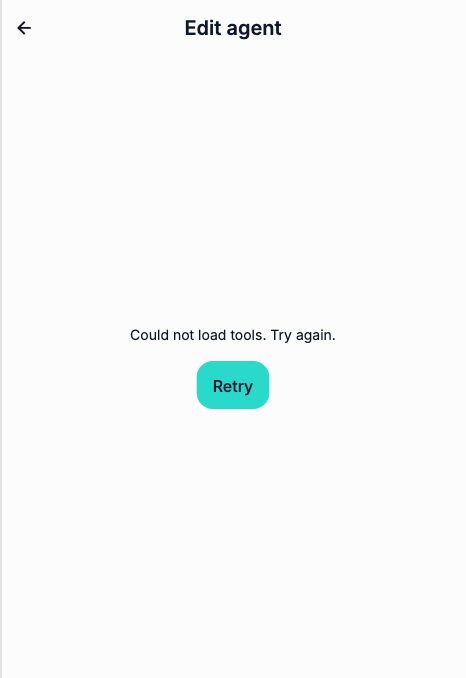 |
| Skills list failure | 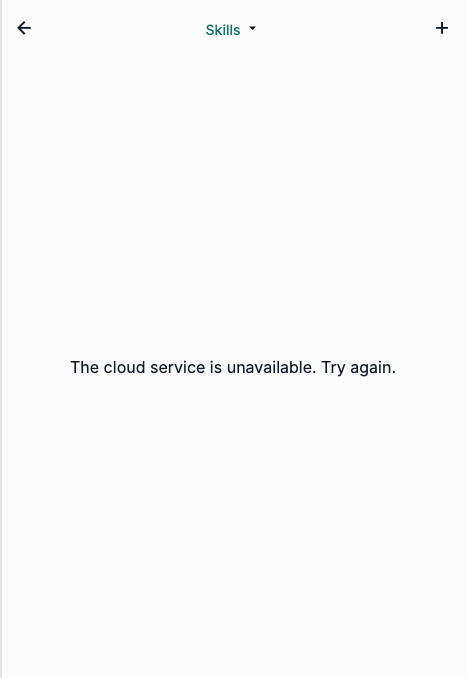 | 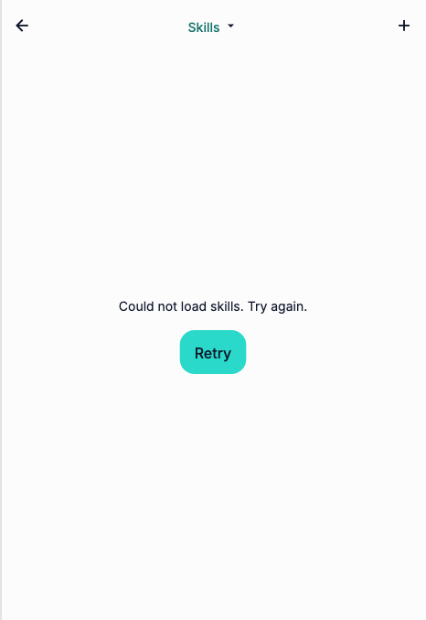 |
| Skill detail failure | Intermediate state: 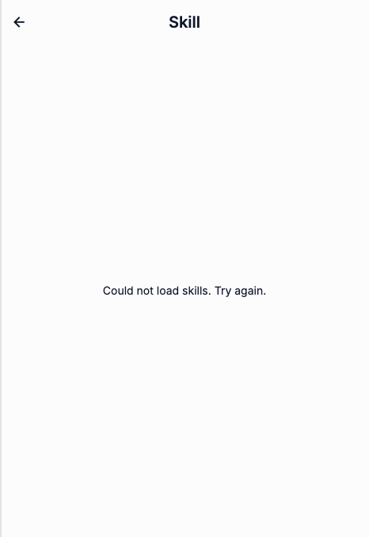 | 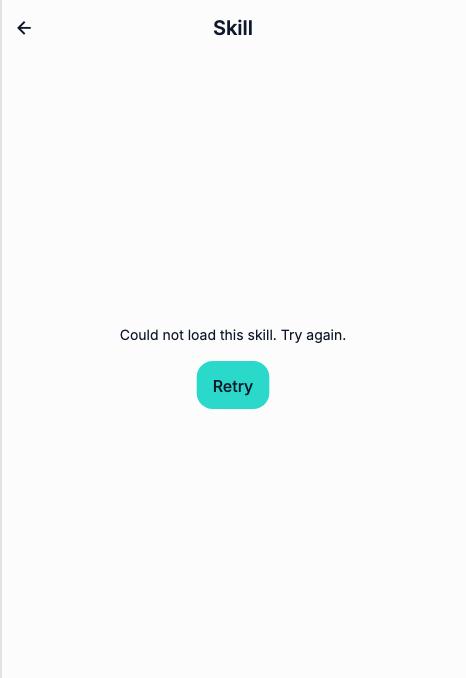 |
| Resource parent failure | Intermediate state: 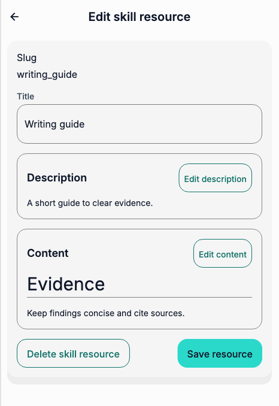 | 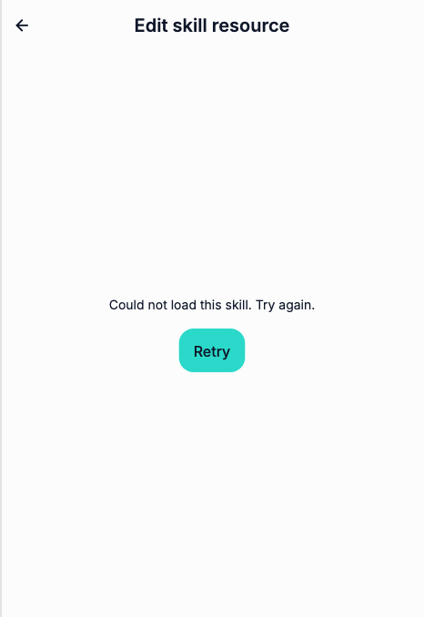 |
| Resource failure | Intermediate state: 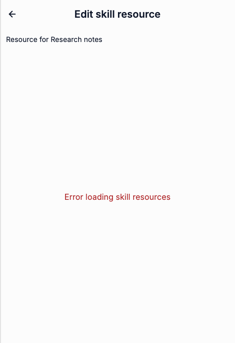 | 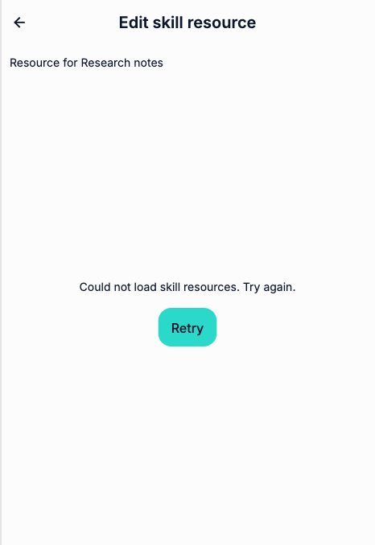 |
| Resource list failure | Intermediate state, different scroll offset: 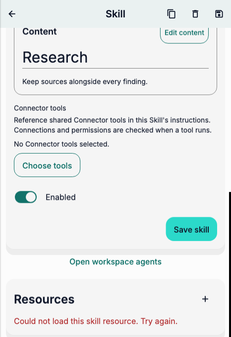 | 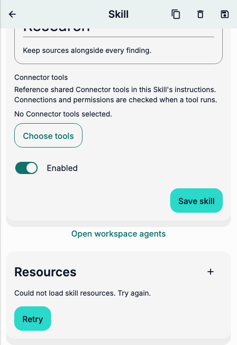 |
| Connected-view tools failure | Mixed-source baseline: 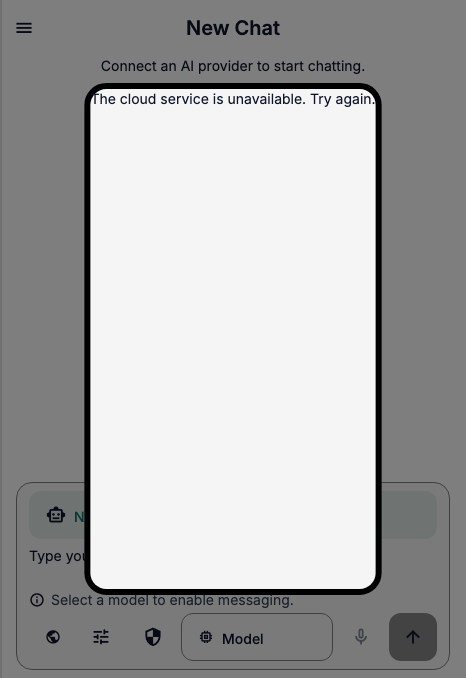 | 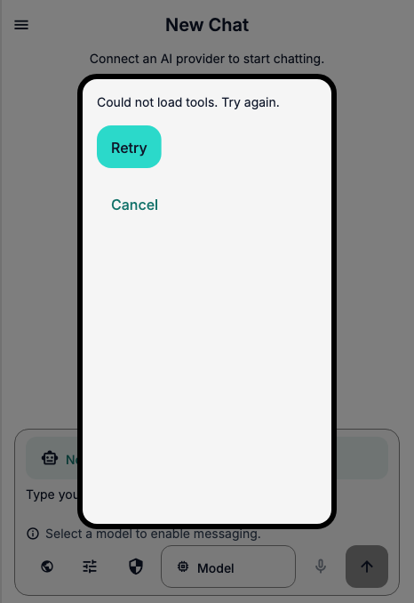 |
| Connected-view Connection failure | Mixed-source baseline: 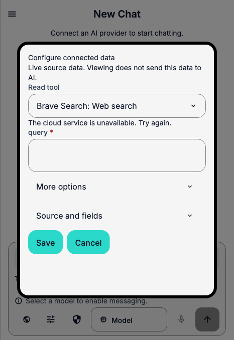 | 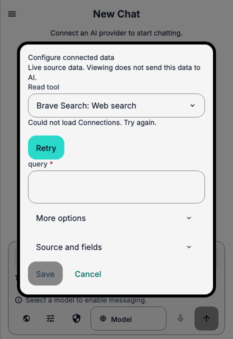 |
| Spanish large text | Earlier iteration: 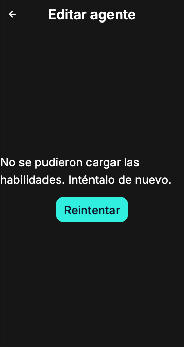 | 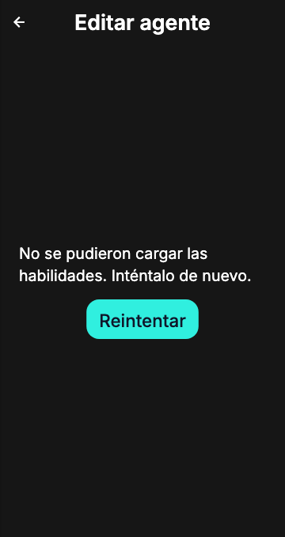 |
