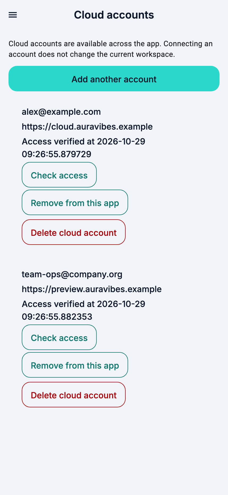
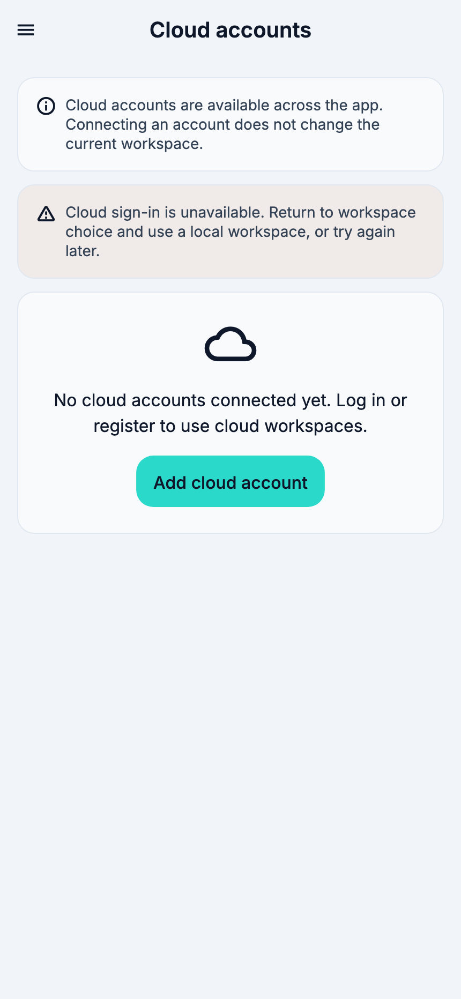

# Cloud accounts UX audit

Scope: randomly selected `CloudAccountsScreen`, which manages cloud account connections, health status, and account lifecycle (removal/deletion). Audit uses code and widget-test evidence. No live analytics or production user sessions were available.

## Iteration 1: scope framing and content-first structure

Finding: the scope notice (`navigation_accounts_scope`) was displayed as plain unstyled text without visual grouping, competing with primary content. The creation CTA (`Add account` / `Add another account`) appeared before the list of existing accounts, inverting content-first visual hierarchy. In empty states, unstyled text sat without clear guidance or a prominent action card.

Recommendation: elevate the scope notice into a framed contextual notice (`AuraCard` with `.bodySmall` and an informational icon) and place it cleanly above the content. Place primary content (connected accounts) first before secondary actions like adding new accounts. For empty states, provide a dedicated centered guidance card with clear typography and a primary call-to-action button.

Fix:
- Wrapped scope and unconfigured notices in structured `_AccountsScopeNotice` and `_AccountsUnconfiguredNotice` cards (`AuraCard` with `.border` style and iconography).
- Reordered the screen so connected accounts render first, followed by the outlined `Add another account` button.
- Implemented `_EmptyAccountState` featuring a centered cloud illustration icon (`Icons.cloud_outlined`), informative guidance, and a prominent primary action button (`Add cloud account`).
- Added widget test coverage for the new empty state layout.

Re-audit: the screen opens with clear purpose and contextual framing. Existing accounts take precedence in the visual order, and the empty state gives immediate, clear guidance.

## Iteration 2: account card structure and typography hierarchy

Finding: account tiles used `AuraTileVariant.ghost` with flat text and no visual separation between accounts. The account's email identifier lacked typographic distinction from surrounding metadata and status text, reducing scannability when multiple accounts are connected.

Recommendation: wrap account sessions in distinct elevated surface cards (`variant: .surface`), include an identity indicator icon (`Icons.account_circle_outlined`), and elevate the account identifier to `.heading6` typography to create an unmistakable focal point for each account.

Fix:
- Refactored `_AccountTile` into a dedicated component with `.surface` styling and vertical padding.
- Added user avatar iconography alongside the account email styled as `AuraTextStyle.heading6`.
- Verified spacing and responsive layout so that server origin and health badges sit comfortably beneath the elevated header.

Re-audit: account entries have strong visual boundaries and clear typographic hierarchy, allowing users to scan and distinguish connected accounts at a glance.

## Iteration 3: action hierarchy and destructive action safety

Finding: management actions ("Remove from this app" and "Delete cloud account") were placed in an unseparated cluster beneath account status. Both buttons shared similar visual prominence (`.outlined`), risking accidental triggers of permanent cloud account deletion instead of simple local session removal.

Recommendation: separate account status and connection health from lifecycle actions with a subtle divider. Differentiate action hierarchy: keep the standard action ("Remove from this app") as `.outlined`, while de-escalating the irreversible action ("Delete cloud account") to a ghost button with error tint (`variant: .ghost`, `tint: .error`, `size: .small`) so users do not mistake it for routine app-level session disconnection.

Fix:
- Added a subtle `Divider` separating status records from management buttons.
- Configured "Remove from this app" as a `.outlined` button (`size: .small`).
- Configured "Delete cloud account" as a de-escalated `.ghost` button with `.error` tint (`size: .small`).
- Maintained responsive wrapping (`Wrap(spacing: 8, runSpacing: 8)`) to prevent overflow across compact viewports and localized translations.

Re-audit: destructive actions are clearly delineated from benign session removals, reducing error slips while preserving immediate access to account lifecycle tools.

## Captures

Widget captures use the standard 430 × 932 mobile viewport frame and app typography tokens.

| Before | After |
| --- | --- |
|  |  |
