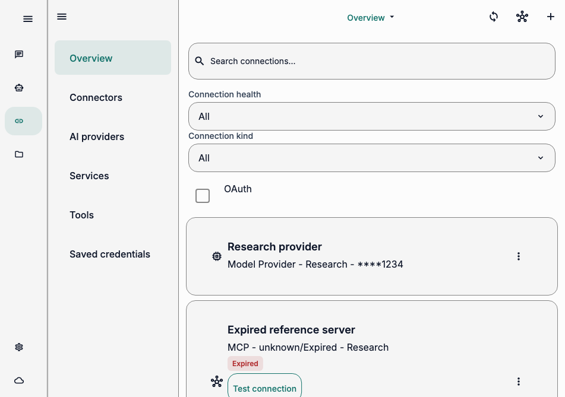
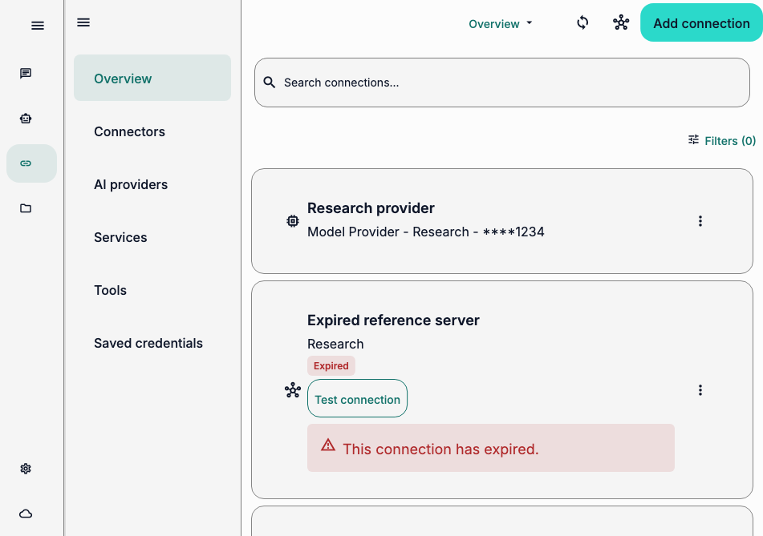

# Connections overview UX audit

- **Date:** 2026-10-29
- **Surface:** Connections → Overview (`ServiceConnectionsScreen`)
- **User goal:** scan connected services, identify connection health, and add or repair a connection.
- **Audience:** everyday users; coding knowledge is not assumed.

## Evidence and limits

This is a heuristic audit grounded in the product target users and product brief. Evidence comes from the production route rendered with the deterministic `MixedConnections` widget-test fixture at 951 × 669 logical pixels, English, light theme, 1× text scale. No real user behavior or analytics was observed. Captures show visible composition only; they do not establish comprehension, native-device behavior, or accessibility conformance.

## Iteration 1 — reduce filter height

**Finding — medium severity, medium confidence.** On entry to Overview, Search is followed by three vertically stacked filter controls. In the 951 × 669 capture, those controls fill the top of the content pane; the first card starts around 370 px down, leaving only one full row and part of the next visible. This delays the main task: scanning connection status.

**Recommendation.** Defer filters to the existing filter sheet when the available content pane is narrow. Keep active-filter count and clear-filter access visible.

**Fix.** Added a Connections-specific 720 px inline-filter breakpoint. Narrow panes now show the existing `Filters (count)` button; the sheet retains all controls and clear-filter behavior. Updated responsive tests to inspect the rendered mode rather than infer it from outer window width.

**Re-audit.** At the same 951 × 669 viewport, filter controls collapse to one `Filters (0)` action and connection cards begin higher in the view. Filter selection remains available through the sheet.

## Iteration 2 — remove implementation details from connection rows

**Finding — medium severity, medium confidence.** The expired server row showed `MCP - unknown/Expired - Research`, while a separate `Expired` badge and warning repeated health state. `MCP` and `unknown` expose implementation/auth details without helping users identify the service or recover.

**Recommendation.** Keep the human-readable service label in the subtitle. Let the existing status badge and warning carry health; keep protocol and auth details out of the overview row.

**Fix.** MCP connection subtitles now show only the service name. Status badges, warning guidance, test action, and connection metadata remain available. Added a regression assertion that the overview does not expose `oauth2` while still showing service name and reconnect status.

**Re-audit.** The row now reads `Research`; `Expired` and its recovery message remain explicit. The `MCP`/`unknown` subtitle is gone.

## Iteration 3 — make primary add action recognizable

**Finding — medium severity, medium confidence.** The app bar presented Add as an unlabeled plus beside Sync and catalog icons. The three icons had similar visual weight, so the core next action was not explicit in the initial view.

**Recommendation.** Give Add a visible label and primary emphasis. Keep Sync and catalog controls as secondary icon actions.

**Fix.** At app-bar widths of 600 px and wider, Add is a filled `Add connection` button. At narrower widths it stays a compact plus button with the same tooltip/semantic label, avoiding app-bar overflow. Both retain the stable identifier and permission-driven disabled state. Added a regression assertion for the visible wide-screen label.

**Re-audit.** The final capture presents `Add connection` as the clear primary action; secondary toolbar actions remain available. Filter summary, service identity, and connection health remain visible.

## Final re-audit

All three findings were addressed in three audit/fix/re-audit cycles. Final screen hierarchy now leads with the add action and connection results, with optional filters deferred. Remaining validation gap: no moderated usability study or native-device capture was run.

## Before and after

Both captures use the same controlled fixture, route, viewport, locale, theme, and text scale.

**Before**

**After**

