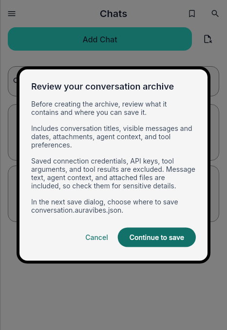
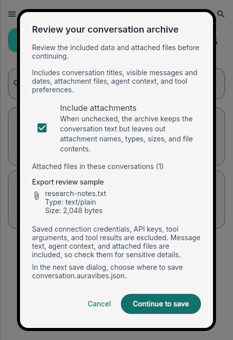

# Conversation archive export review

The review dialog now previews the archive contents before the user continues to the operating-system save picker. It shows the suggested filename and makes clear that the picker chooses the actual save location. Attachment inclusion is explicit, with each included attachment's name, MIME type, and size shown before export. Excluding attachments retains the conversation text and ordering while omitting attachment payloads and metadata.

| | Capture |
| --- | --- |
| Before |  |
| After |  |

Both images use the same 466 × 678 light-theme widget-test viewport, English locale, 1.0 text scale, and a synthetic local conversation containing one text attachment. The fixture points to a nonexistent file, so the captures do not read or expose attachment bytes. They were rendered by the hosted UX validation workflow at [run 41654678448](https://github.com/auravibes-apps/auravibes/actions/runs/41654678448). The before source fingerprint is base `46065bc5983bc9dc9100696aaa3c98ba66c7c56b`; the after source fingerprint is `a7fe3506ad3522110e1a70c55b52b4d64bf85a6d`. Provenance sidecars are in `before.json` and `after.json`.
