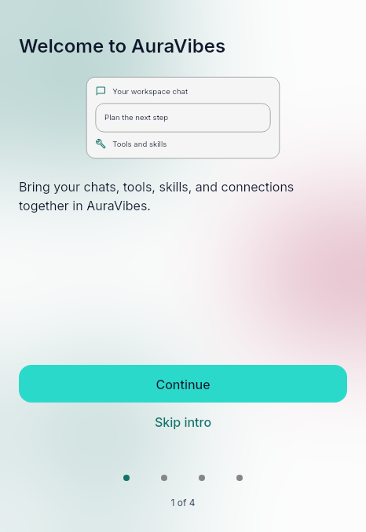
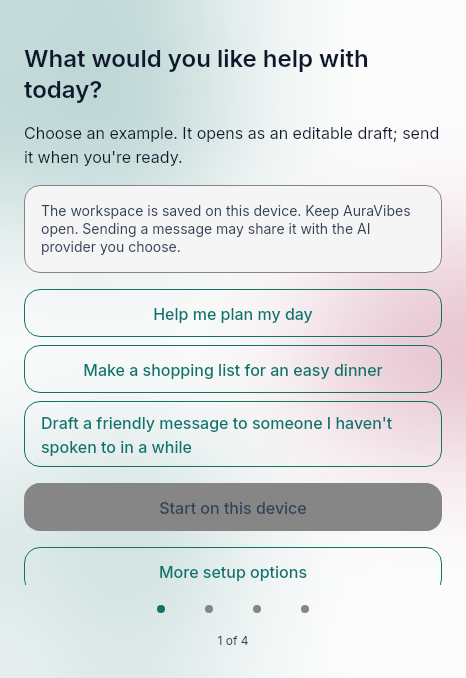
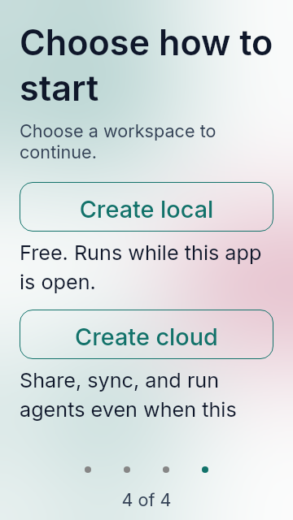
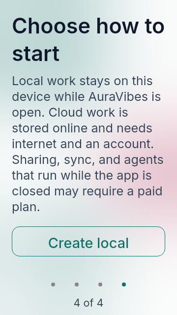
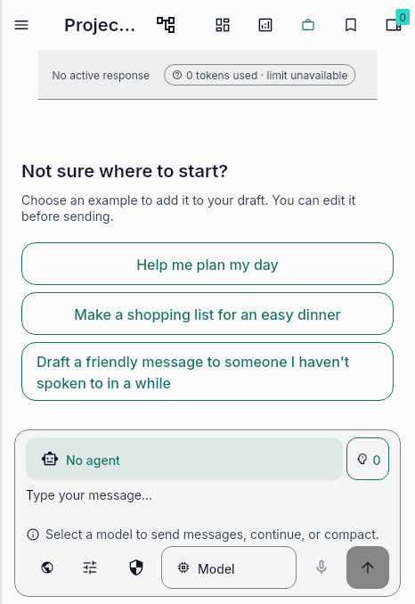

# First-use and empty-conversation UX audit

Scope: onboarding first-use guide (#1527) and the shared everyday-starter
catalog in an empty conversation (#1529). The approved plan keeps both issue
acceptance scopes explicit while reusing one English/Spanish prompt catalog.

## Capture provenance

The six real-font captures were produced by [hosted workflow run 41511423153](https://github.com/auravibes-apps/auravibes/actions/runs/41511423153)
on feature SHA `f3cb16c4bc6cd3b5c817ec58c8bc23d223310925`, compared with pinned
main SHA `1aaa31f61128fe810ca35ef7a00205edb9233175`. The artifact is
`first-chat-ui-evidence-41511423153-1`. Each image has a sidecar with its route,
fixture, source fingerprint, renderer, viewport, locale, scale, theme, and font
metadata; `capture-manifest.json` maps all six images to those sidecars.

The captures use Flutter widget-test Skia on Linux, locale `en`, light theme,
and the app's Inter, Roboto, and Material Icons fonts. They do not represent
native system typography or screen-reader output.

## #1527 — first-use guide and setup choices

Before, `/intro` opens with an abstract welcome message and a generic
Continue/Skip choice. After, it begins with three everyday tasks and explains
that a workspace is stored on this device, AuraVibes needs to stay open, and
sending a message may share it with the selected AI provider. Starter prompts
remain editable drafts; the local-start action stays disabled until a prompt is
selected. The focused handoff tests cover opening an editable draft without
sending and preserving later edits.

The advanced setup view explains local storage and app-open requirements,
cloud storage and internet/account requirements, and possible paid-plan
requirements before the corresponding setup choices. At the 360 × 640, 1.8x
capture, the copy and local action are visible first; the cloud action is below
the fold in the scrollable view.

| Before | After |
| --- | --- |
|  |  |
|  |  |

## #1529 — empty-conversation starters

The baseline already contains the empty-conversation behavior covered by #1529
and delivered in #1767. The feature branch extracts its localized starter
definitions into the catalog shared with onboarding, so no visual change is
expected in this route. The before/after images are pixel-identical and show
the same three draft starters, empty composer, and no messages. Regression
coverage keeps the visibility gate, editable insertion without sending,
existing-draft preservation, message-history behavior, and localized accessible
labels explicit.

| Before | After |
| --- | --- |
|  |  |

## Review notes

- The onboarding screenshot shows the guide before any prompt is selected, so
  the local-start button is disabled as intended.
- The 1.8x setup view keeps the local/cloud storage, internet, account, and
  possible paid-plan disclosure above the choices. The cloud action requires
  scrolling at this viewport.
- The empty-conversation route has an empty history and empty composer. Its
  existing starters remain available only in that state and fill a draft
  without sending.
- Focused tests cover both issue scopes; the hosted capture workflow verifies
  the exact final feature SHA and all capture metadata.
