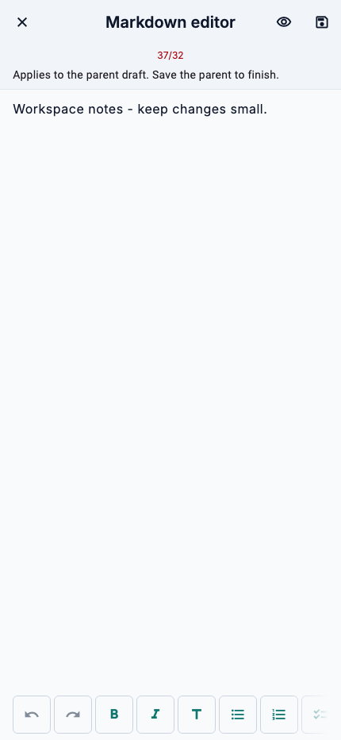
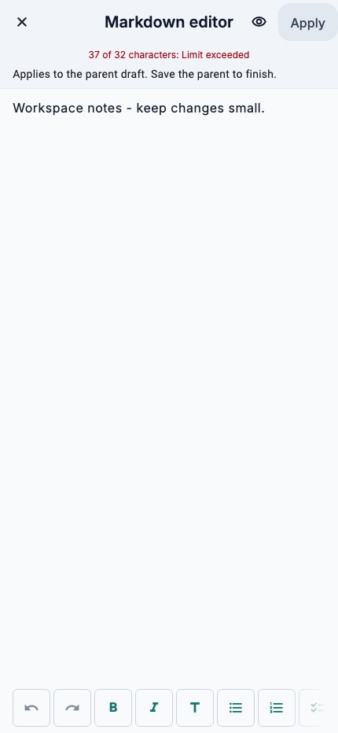

# Markdown editor UX audit

Scope: randomly selected `MarkdownEditorScreen`, used by agent instructions and skill/resource content. Audit uses code and widget-test evidence. No user sessions or analytics were available.

## Iteration 1: character limit feedback

Finding: the counter showed `37/32` in error color, while Apply stayed disabled without saying why.

Recommendation: state current count, limit, and exceeded status in localized text. Keep entered content intact and let Apply recover when the user shortens it.

Fix: show `{count} of {limit} characters: Limit exceeded` in English and Spanish. Added a narrow-width regression for overflow, disabled Apply, and recovery after shortening.

Re-audit: feedback fits a 360 px viewport and explains why Apply is unavailable.

## Iteration 2: Apply action discoverability

Finding: Apply used only a save icon; the label appeared only on hover or assistive technology.

Recommendation: show an action word on the button.

Fix: use visible `Apply` / `Aplicar` text, retaining the disabled state when the limit is exceeded. Updated editor callers' widget regressions.

Re-audit: action is understandable without icon recognition or hover. Existing caller save actions remain separate.

## Iteration 3: preview toggle semantics

Finding: the preview toggle's accessible name remained `Preview` after entering preview mode, when its action was to return to editing.

Recommendation: name the action users can take in the current state.

Fix: use `Preview` while editing and `Edit Markdown` / `Editar Markdown` while previewing for both semantics and tooltip.

Re-audit: action name follows the state; existing selection restoration and editor focus behavior stay covered.

## Captures

Widget captures use the same 430 × 932 frame and app fonts. Native simulator/emulator capture was unavailable in this environment.

| Before | After |
| --- | --- |
|  |  |
