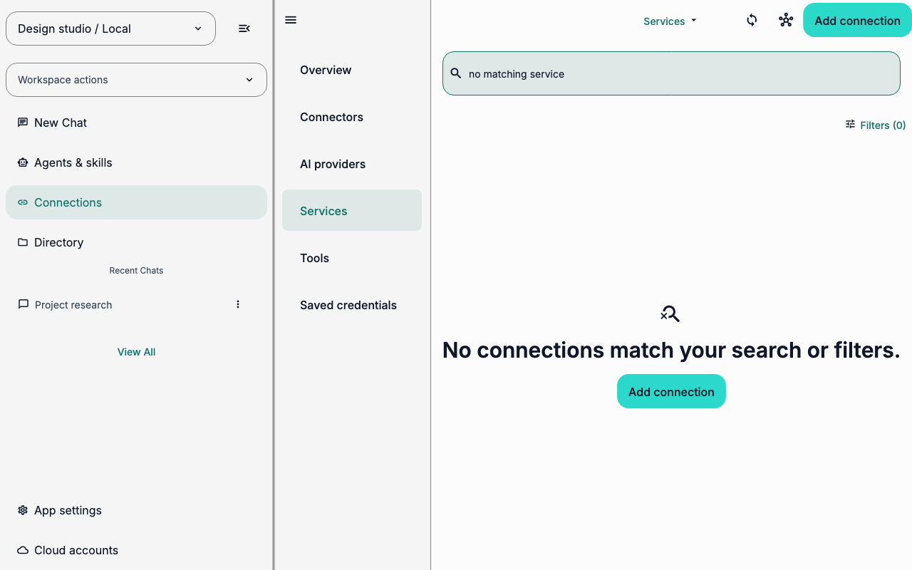
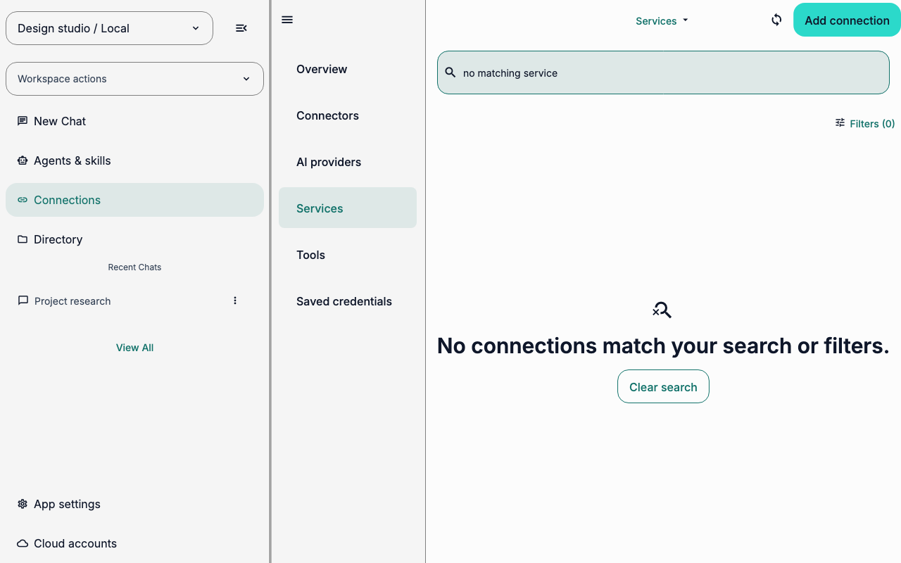
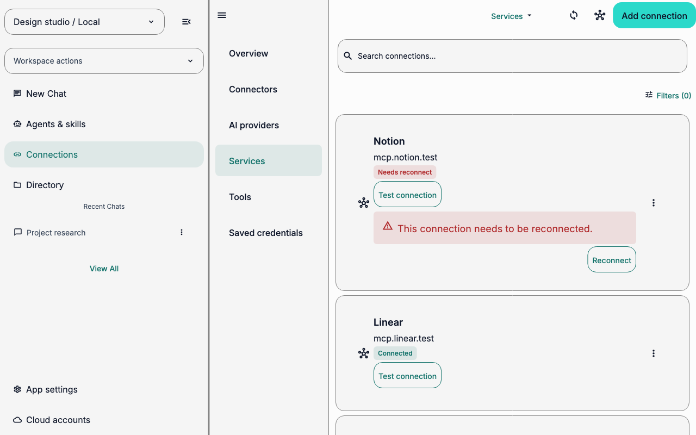
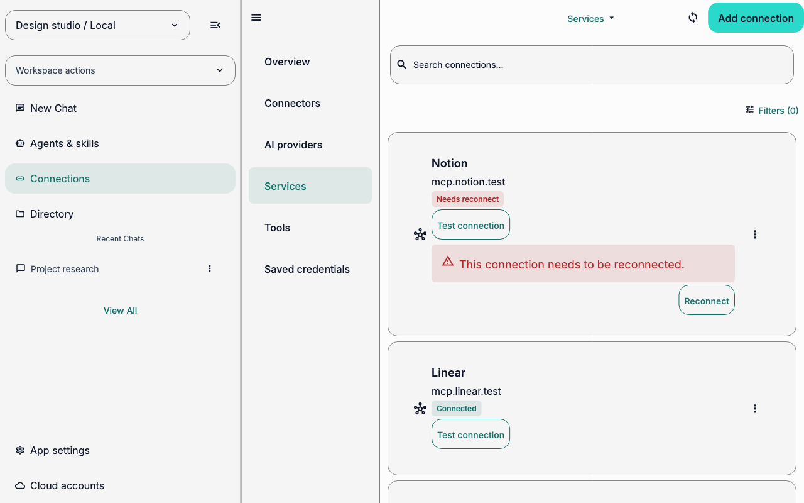
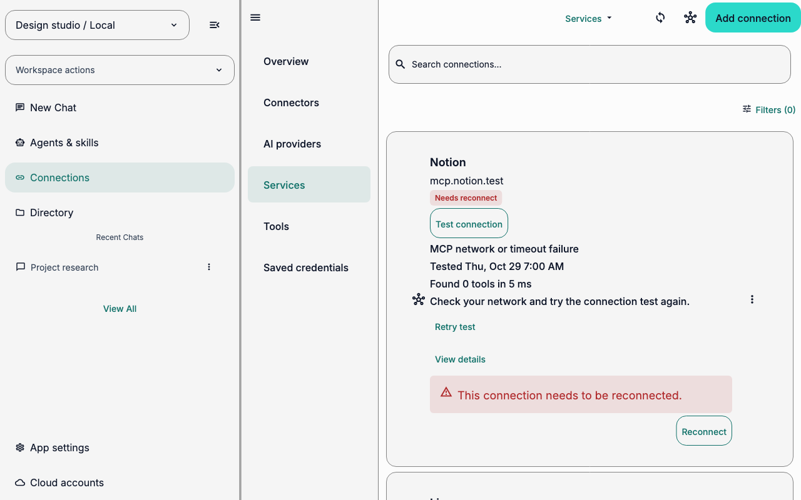

# Service connections UX audit

- **Date:** 2026-10-29
- **Surface:** Connections → Services (`ServiceConnectionsScreen`)
- **User goal:** identify a service's connection health, recover access when a check fails, and add a service when needed.
- **Success result:** the person can identify a service, choose an appropriate recovery action, and return to the service list or catalog.
- **Audience:** everyday AuraVibes users; coding knowledge is not assumed.

## What changed

- **Services toolbar:** removed the catalog icon because it opened the same catalog as `Add connection`.
- **Search with no matches:** replaced the unrelated `Add connection` recovery action with `Clear search`.
- **Failed connection check:** replaced MCP and timeout jargon with a plain service status and next step.

Each before/after pair shows the full Services route. Captions name the visible change. PNG sidecars record the route, controlled fixture, source commit, viewport, renderer, and font limits.

## Evidence and limits

This is a heuristic, code-based audit. It follows the production Services route with a deterministic fixture containing Notion (needs reconnect), Linear (connected), and Sentry (failed). Captures use the same 1280 × 800 logical-pixel viewport, English locale, light theme, and 1× text scale. The route runs under Flutter's widget-test Skia renderer on macOS; it does not represent native platform typography, assistive technology, or observed user behavior. Each PNG has a JSON sidecar with its route, fixture, source fingerprint, renderer, fonts, and viewport.

## Iteration 1 — recover from a search with no matches

**Task step:** find a service by name, then recover when the query matches nothing.

**Evidence:** the before capture shows the empty-search message and an `Add connection` action in the list. In Services, that action opens the catalog while the unmatched query remains active. The search input's controller was initialized from state but did not follow later state changes.

**Problem and impact:** the empty state offers a different task from the one that failed. A person must edit the query manually or leave the list to recover. **Severity: medium. Confidence: high** from the rendered state, route behavior, and test coverage.

**Recommendation:** show `Clear search` when a non-empty query has no results. Keep `Add connection` for empty results caused by filters, and keep the text field synchronized with search state.

**Fix:** added a localized clear-search action for unmatched queries and synchronized the search controller when state changes.

**Verification and re-audit:** `searches connection metadata and applies status filters` enters a missing query, clears it, confirms the field empties, and confirms Notion returns. The after capture shows `Clear search` under the no-match message.

**Before — unmatched query offers Add connection:**

**After — unmatched query offers Clear search:**

[Before capture metadata](search-before.json) · [After capture metadata](search-after.json)

## Iteration 2 — remove the duplicate catalog entry action

**Task step:** open the service catalog from Services.

**Evidence:** the before capture shows both the catalog icon and `Add connection` in the toolbar. In this view, both callbacks open the same service catalog.

**Problem and impact:** two controls present one destination as separate choices. This adds avoidable scanning and leaves the icon's purpose less clear. **Severity: medium. Confidence: high** from the rendered route and callback inspection.

**Recommendation:** keep one clear `Add connection` action on Services. Preserve the separate catalog action on other connection views where it has a distinct role.

**Fix:** hid the redundant catalog icon on Services. Kept `Add connection` and the separate model-catalog sync action.

**Verification and re-audit:** `shows one catalog entry action in services view` confirms the duplicate catalog tooltip is absent and the add action remains. The after capture shows one catalog entry action.

**Before — catalog icon and Add connection open the same catalog:**

[Before capture metadata](before.json)

**After — one catalog entry action remains:**

[After capture metadata](after.json)

## Iteration 3 — explain connection failures in everyday language

**Task step:** understand a failed connection check and choose a recovery action.

**Evidence:** the before capture says `MCP network or timeout failure` and `Check your network and try the connection test again.` The source also used MCP-specific labels and error messages in English and Spanish.

**Problem and impact:** protocol and timeout wording exposes implementation details without telling a person what to do. **Severity: medium. Confidence: medium**; the messages are visible and code-backed, but no user comprehension study was run.

**Recommendation:** state the service problem and the next useful action. Keep technical transport details in the diagnostic details view.

**Fix:** replaced MCP-specific connection labels and test messages with service language in English and Spanish. Network failures now say `Could not reach this service` and `Check your internet connection, then try again.` Authentication and configuration failures also use plain-language descriptions and recovery steps. Technical diagnostic details remain available through `View details`.

**Verification and re-audit:** service-screen tests cover English network and configuration errors and Spanish authentication recovery. The after capture uses the same controlled network failure and shows the simpler message and next step.

**Before — protocol language:**

[Before capture metadata](diagnostic-before.json)

**After — clear problem and next step:**

[After capture metadata](diagnostic-after.json)

## Final re-audit

Three audit/fix/re-audit cycles are complete. The search state now offers direct recovery, Services has one catalog entry action, and connection-check feedback uses clearer localized language. The captures show the real route and state; the text above explains what changed and why. Remaining validation gap: no moderated usability study or native-device capture was run.
